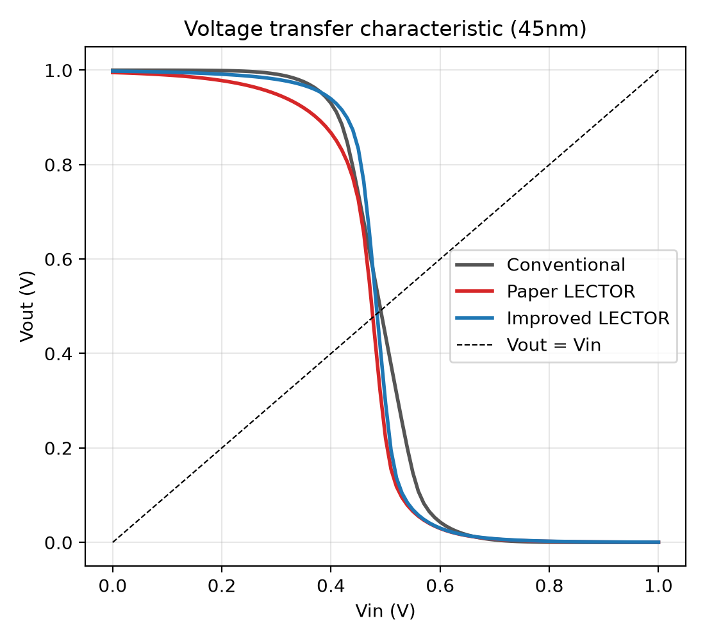
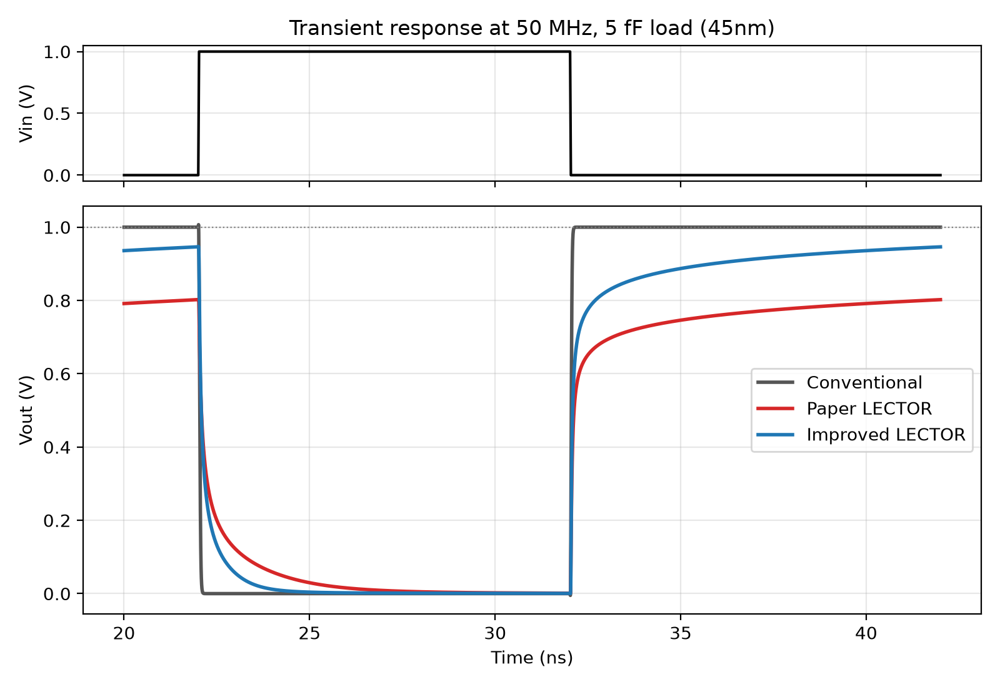
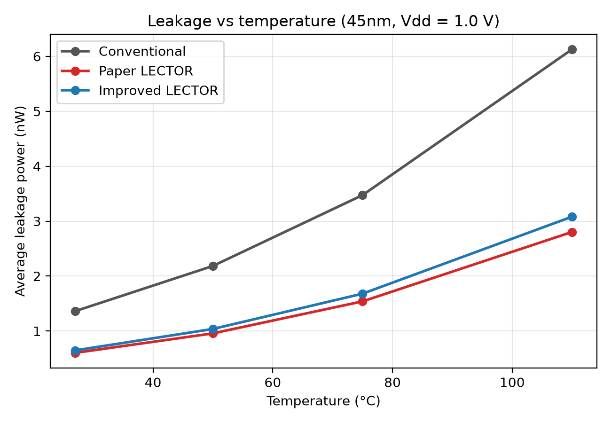
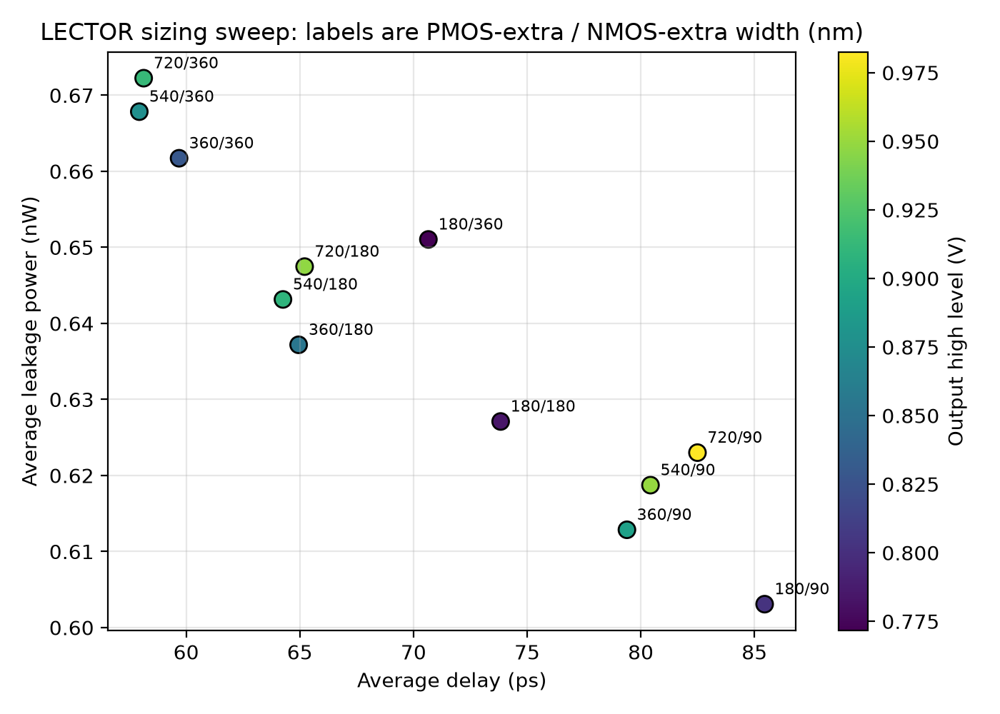
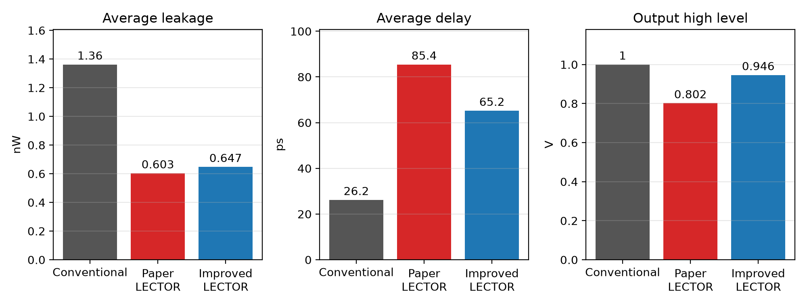

# Leakage Reduction in a CMOS Inverter at the 45nm Node

### Implementing the LECTOR technique, improving it, and testing when it pays off (ngspice, PTM 45nm HP)

This project implements the **LECTOR** leakage-reduction technique on a CMOS inverter, measures its benefits and limitations in SPICE, improves it by re-sizing its two extra transistors, and then tests how far the conclusions hold (noise margins, break-even switching activity, equal-delay comparison, threshold-voltage corners). Everything is simulated in ngspice with the 45nm High-Performance Predictive Technology Model (PTM).

| Design | What was simulated |
|---|---|
| **Conventional** | Standard 2-transistor inverter (reference) |
| **Paper LECTOR** ("before") | LECTOR inverter as published, with the two extra transistors the same size as the main ones |
| **Improved LECTOR** ("after") | Same topology, with the extra PMOS widened to 720 nm and the extra NMOS to 180 nm |

## Summary of findings

- LECTOR cuts average leakage by about **56%** at 27 °C, and by roughly half from 27 to 110 °C.
- It has real costs: delay about **3.3x** a conventional inverter, a weak output "1" (0.80 V at 50 MHz), twice the transistors.
- Widening the extra transistors recovers much of that: delay **-24%**, output level **+0.14 V**, for **+7%** leakage, compared with the unsized LECTOR.
- **At equal delay LECTOR loses its leakage benefit** in this single-inverter setting (it has to be scaled up 3.6x to 6.4x and then leaks more than the conventional gate).
- It only saves total power for gates that **switch rarely** (below about 3% of the time at 27 °C, about 11% at 110 °C).
- Lower threshold voltages help LECTOR; higher ones hurt it.

## Key results

Conditions: 45nm PTM HP, Vdd = 1.0 V, 27 °C, 50 MHz square-wave input (20 ps edges), 5 fF load. Delays are measured in the second clock cycle (steady state). The last digit may differ by about 0.1 ps between ngspice versions.

| Metric | Conventional | Paper LECTOR | Improved LECTOR |
|---|---|---|---|
| Avg leakage power | 1.362 nW | 0.603 nW (-55.7%) | 0.647 nW (-52.5%) |
| Leakage, Vin = 0 / Vin = 1 | 1.952 / 0.772 nW | 0.969 / 0.237 nW | 1.019 / 0.276 nW |
| tpHL / tpLH | 29.8 / 22.5 ps | 73.9 / 97.0 ps | 71.6 / 58.8 ps |
| Avg delay | 26.2 ps | 85.4 ps (+227%) | 65.2 ps (+149%) |
| Output high level (50 MHz) | 1.00 V | 0.80 V | 0.95 V |
| Dynamic power | 0.268 uW | 0.225 uW | 0.294 uW |
| Power-delay product | 7.0 aJ | 19.2 aJ | 19.2 aJ |
| Transistors / total width | 2 / 270 nm | 4 / 540 nm | 4 / 1170 nm |

**Improvement over the unsized LECTOR:** average delay -23.7%, output high level +0.14 V, at the cost of +7.4% leakage and about 2x the total transistor width. The unsized LECTOR's lower dynamic power comes mainly from its smaller output swing, so it should not be read as a saving.

### Leakage vs temperature (average of both input states)

| Temperature | Conventional | Paper LECTOR | Improved LECTOR |
|---|---|---|---|
| 27 °C | 1.36 nW | 0.60 nW | 0.65 nW |
| 50 °C | 2.18 nW | 0.96 nW | 1.04 nW |
| 75 °C | 3.47 nW | 1.54 nW | 1.68 nW |
| 110 °C | 6.13 nW | 2.80 nW | 3.08 nW |

## Additional analyses

| Analysis | Result |
|---|---|
| **Noise margins** | Static high/low margins are as good as the conventional inverter's. At 50 MHz the high-side margin falls from 0.41 V to **0.25 V** (paper LECTOR, -38%) and **0.39 V** (improved, -6%). |
| **Break-even activity** | The improved LECTOR saves 0.71 nW of leakage but draws 26.9 nW more dynamic power at full switching. It reduces total power only if the gate toggles less than **2.7%** of the time at 50 MHz (27 °C); **4.3%, 6.7%, 11.3%** at 50, 75, 110 °C. |
| **Iso-delay** | Scaling all LECTOR transistors until the delay equals the conventional 26.2 ps needs k = 3.6x to 6.4x. Leakage is then **1.8x to 3.2x higher** than the conventional inverter, with 9x to 26x the width. |
| **Shrunk conventional inverter** | A conventional inverter shrunk to LECTOR's delay would leak less (0.33 nW vs 0.60 nW), but needs widths below 45 nm that are probably not manufacturable, and the model may be inaccurate there. |
| **Threshold corners** (|Vth| -50 mV / nominal / +50 mV) | Improved LECTOR leakage reduction **55.6% / 52.5% / 42.8%**, delay penalty +136% / +149% / +168%, output high 0.99 / 0.95 / 0.90 V. |

Reading: the leakage saving is real but conditional. It needs a gate that may be slower than a minimum-size conventional gate, that switches rarely, and ideally a low threshold voltage. The original work reaches equal delay by also resizing other transistors on circuits with timing slack, which a single inverter cannot reproduce.

## Figures

| | |
|---|---|
|  |  |
|  |  |
|  | |

1. **VTC:** the gate still switches near 0.5 V; the unsized LECTOR sags slightly at the top.
2. **Transient:** the LECTOR outputs creep slowly toward the high level; the improved design gets much closer.
3. **Leakage vs temperature:** all designs rise about 4.5x to 4.8x from 27 to 110 °C; LECTOR stays at about half of the conventional leakage.
4. **Sizing sweep:** 12 width combinations; lower-left is better, colour is the output level.
5. **Before/after bars:** leakage, delay and output level at 27 °C.

## What is new and what is not

- The LECTOR topology and the idea of **sizing the extra transistors to recover delay come from the original work** (Hanchate and Ranganathan, and the related patent). This project does not claim either.
- Added here: a re-evaluation on a 45nm PTM HP inverter with state-resolved leakage; a steady-state, 50 MHz evaluation that exposes the weak output level and the history-dependent delay; independent sizing of the extra PMOS and NMOS (the PMOS one mainly sets the output level, the NMOS one mainly sets the speed); temperature, noise-margin, break-even, iso-delay and threshold-corner analyses; and a reproducible open-source flow.
- The improved design is **not delay-neutral**: it is still about 2.5x slower than the conventional inverter.

## Repository layout

```
.
├── netlists/45nm/
│   ├── 5_all_designs.cir        main results: all three designs (leakage, delay, power, output level)
│   ├── 3_lector_sweep.cir       sizing sweep of the extra transistors
│   ├── 4_leak_vs_temp.cir       leakage vs temperature
│   ├── 6_export_waveforms.cir   writes VTC and transient data for the plots
│   └── 1_*, 2_*                 early step-by-step netlists (first-cycle delay measurement)
├── scripts/
│   ├── plot_all.py              draws the five figures
│   ├── lector_sim.py            helper: runs one design in ngspice and returns its metrics
│   ├── noise_and_breakeven.py   noise margins and break-even activity
│   ├── iso_delay.py             equal-delay comparison
│   └── vth_corners.py           threshold-voltage corners
├── results/                     data files, saved script outputs and the five figures
└── models/                      NOT included (see "Model cards")
```

The early netlists (`1_*`, `2_*`) measure delay on the first clock cycle only. Use `5_all_designs.cir` for the final numbers.

## Circuits

Conventional inverter: PMOS W = 180 nm, NMOS W = 90 nm, L = 45 nm.

LECTOR adds two transistors between the pull-up and pull-down transistors, with the output at their common drain. The gate of each extra transistor is driven by the source of the other:

```
Mp   a    in   vdd  vdd  pmos      pull-up
Mlp  out  b    a    vdd  pmos      extra PMOS, gate = b
Mln  out  a    b    0    nmos      extra NMOS, gate = a
Mn   b    in   0    0    nmos      pull-down
```

## Model cards

The PTM 45nm HP model card is not included. Download `45nm_HP.pm` from the Predictive Technology Model site (ptm.asu.edu, Arizona State University) and place it in `models/`. It defines models named `nmos` and `pmos` (BSIM4, level 54, nominal Vdd 1.0 V). If you use PTM, please cite Cao et al. (reference 3).

## Reproducing the results

Requirements: ngspice (tested with ngspice-47, inside IIC-OSIC-TOOLS) and Python 3 with numpy and matplotlib. Run from the repository root, with `models/45nm_HP.pm` in place.

```bash
cd netlists/45nm
ngspice -b 5_all_designs.cir | grep -E "^conv|^paper|^improved" > ../../results/all_designs_summary.txt
ngspice -b 3_lector_sweep.cir | grep -E "^[0-9]+n " > ../../results/sizing_sweep.txt
ngspice -b 4_leak_vs_temp.cir | grep -E "^[0-9]+ [01]" > ../../results/leak_vs_temp.txt
ngspice -b 6_export_waveforms.cir
cd ../../scripts
python3 plot_all.py
python3 noise_and_breakeven.py | tee ../results/noise_breakeven.txt
python3 iso_delay.py           | tee ../results/iso_delay.txt
python3 vth_corners.py         | tee ../results/vth_corners.txt
```

`5_all_designs.cir` prints one line per design: `leak(Vin=0) leak(Vin=1) | tpHL tpLH | average supply current | output high`. Leakage is in amps (multiply by Vdd = 1.0 V for watts), delays in seconds, and the supply current is negative by ngspice's sign convention.

## Limitations

- One gate, one technology node (45nm), one load (5 fF) and one frequency (50 MHz).
- PTM is a predictive model, not a foundry design kit. Only two deterministic threshold corners were run, not a Monte Carlo analysis.
- "Average leakage" assumes the gate spends equal time in both input states.
- The break-even analysis uses a simple model (dynamic power proportional to activity, extra dynamic power held at its 27 °C value for higher temperatures).
- The shrunk-conventional comparison uses transistor widths below the channel length, which may be below the technology's minimum width.
- The LECTOR connection follows the paper's description (each extra transistor's gate driven by the other's source); compare it with the paper's own figure.

## References

1. N. Hanchate and N. Ranganathan, "LECTOR: A Technique for Leakage Reduction in CMOS Circuits," IEEE Trans. VLSI Syst., vol. 12, no. 2, pp. 196-205, 2004, doi:10.1109/TVLSI.2003.821547.
2. K. Roy, S. Mukhopadhyay and H. Mahmoodi-Meimand, "Leakage current mechanisms and leakage reduction techniques in deep-submicrometer CMOS circuits," Proc. IEEE, 2003.
3. Y. Cao et al., "New generation of Predictive Technology Model for sub-45 nm early design exploration," IEEE Trans. Electron Devices, vol. 53, no. 11, pp. 2816-2823, 2006.
4. N. Ranganathan and N. Hanchate, "Method and apparatus for reducing leakage in integrated circuits," US Patent 7,256,608, 2007.
5. M. C. Johnson, D. Somasekhar, L.-Y. Chiou and K. Roy, "Leakage control and efficient use of transistor stacks in single threshold CMOS," IEEE Trans. VLSI Syst., vol. 10, no. 1, pp. 1-5, 2002.
